# Hephaestus HydroTemp

**Precision water-temperature control with an ESP32, a time-proportional SSR and a PID loop, supervised over Modbus TCP.**

  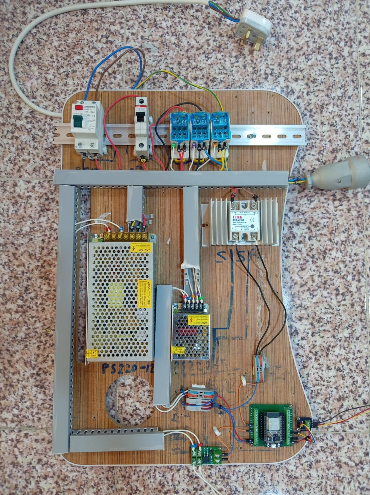
  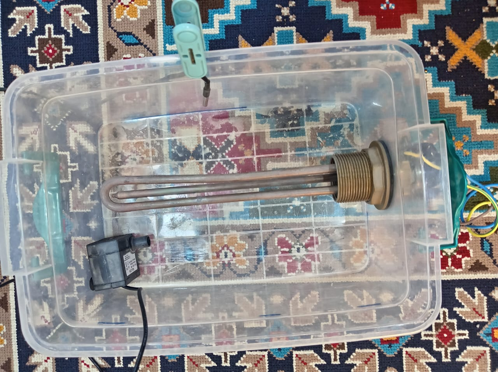

## Overview

Hephaestus HydroTemp is a complete closed-loop temperature-control system built from the mains inlet to the supervisory interface: protected 220 V power stage, galvanically isolated actuation, a digital sensor, an ESP32 running a PID controller, and a Modbus TCP server that lets an HMI on a PC change setpoint and gains and monitor the process live.

The plant is an 800 W immersion heater in a water tank, with a small pump for thermal homogeneity. The controller drives the heater through a solid-state relay using a 2 s time-proportional window, and drives the pump with a fixed-duty 20 kHz PWM for quiet, gentle mixing.

### Results at a glance

| Metric | Final tuning (Kp = 40, Ki = 0.03, Kd = 1) |
|---|---|
| Setpoint tested | 46 °C (step from 41 °C) |
| Overshoot | 0.1 °C |
| Steady-state error | +0.02 °C (sensor resolution is 0.125 °C) |
| Time to reach setpoint | about 220 s |
| Controller sample time | 2 s |

The full tuning campaign, including the runs that failed and why, is in [Tuning and results](#tuning-and-results).

### What this project demonstrates

- Closed-loop PID design, manual tuning on a real plant, and analysis of saturation, steady-state error and integral behavior
- Time-proportional (slow-PWM) power control with an SSR
- Non-blocking embedded firmware architecture on the ESP32
- Industrial-style supervision: a Modbus TCP register map with scaling, range validation and persistent settings
- Layered safety: RCD, MCB, galvanic isolation, sensor-fault and over-temperature trips, fail-safe outputs
- Mains-side panel assembly with earthing, protection and clear wiring practice

## System architecture

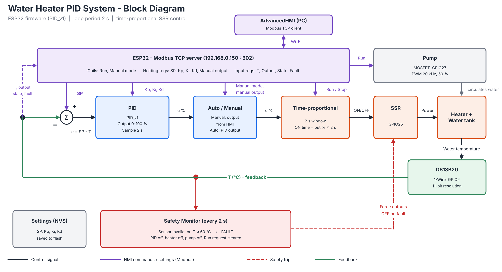

The loop computes `e = SP - T` every 2 s. The PID output (0 to 100 %) passes through an Auto/Manual selector and is converted to an ON time within a 2 s window (`ON time = out % x 2 s`) that gates the SSR. A safety monitor runs on the same 2 s tick and forces all outputs off on a fault. The HMI never touches the outputs directly; it only writes commands and settings, which the firmware validates before applying.

## System Workflow & Control Logic

The system operates based on a clear, state-driven control loop ensuring high precision, real-time response, and safety execution:

  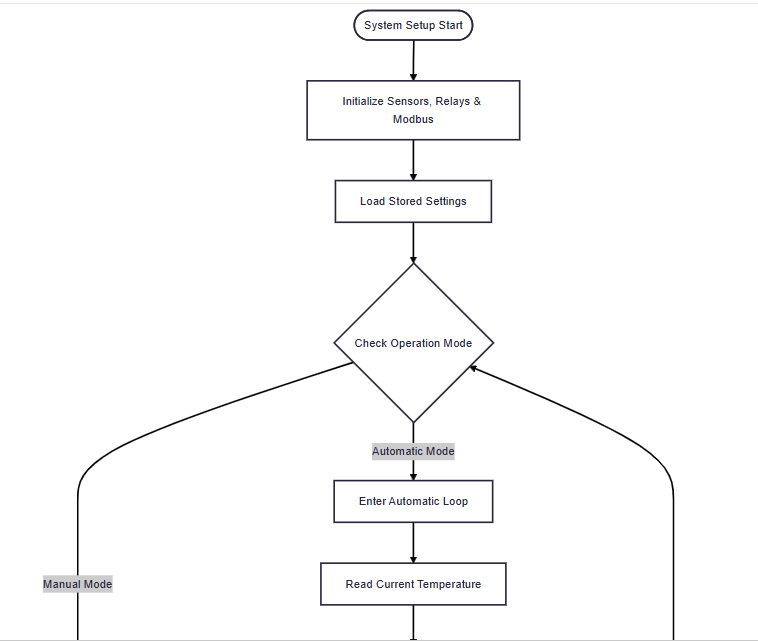
  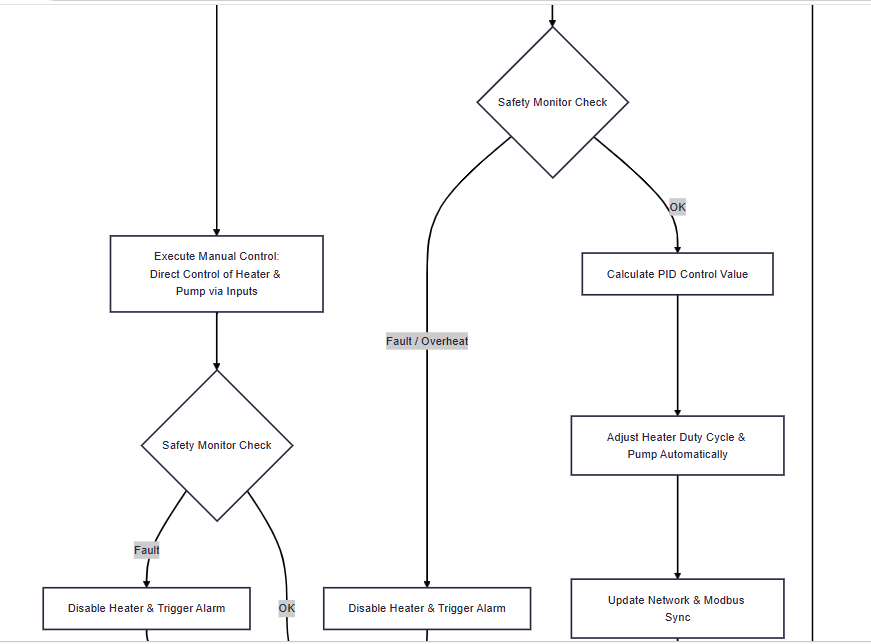
  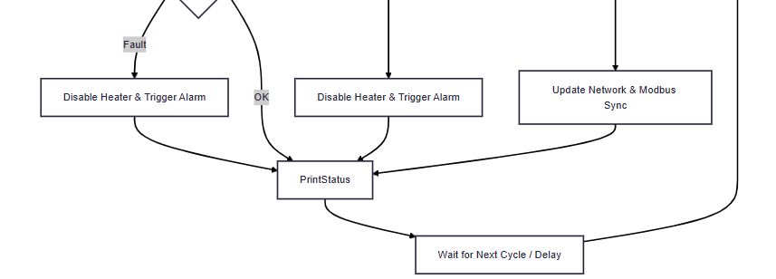

### 1. System Initialization
1. **System Setup Start**: System boots and initializes input/output pins.[cite: 1]
2. **Hardware & Communication Setup**: Initializes temperature sensors, relays, and Modbus RTU/TCP protocols.[cite: 1]
3. **Load Stored Settings**: Restores previously saved PID control parameters and system limits.[cite: 1]
4. **Operation Mode Decision**: Checks the current operation mode: **Automatic** or **Manual**.[cite: 1]

---

### 2. Automatic Control Mode (PID Regulation)
* **Temperature Reading**: Reads current real-time water temperature from the sensors.[cite: 1]
* **Safety Check**: Evaluates for faults or overheating conditions.[cite: 2]
  * **Status: OK**: Calculates necessary duty cycle via **PID Control Algorithm**.[cite: 2]
  * **Status: Fault / Overheat**: Automatically disables the heater and triggers an immediate safety alarm.[cite: 2]
* **Actuator Adjustment**: Dynamically adjusts heater Duty Cycle (PWM/SSR) and pump states.[cite: 2]
* **Network Sync**: Synchronizes system telemetry across Modbus and network interfaces.[cite: 2, 3]

---

### 3. Manual Control Mode
* **Direct Control**: Allows operators to manually trigger the heater and pump via direct inputs.[cite: 2]
* **Safety Monitor Check**: Maintains continuous background safety monitoring.[cite: 2]
  * **Status: OK**: Proceeds directly to output status printing.[cite: 2, 3]
  * **Status: Fault**: Overrides manual commands, disables the heater, and triggers the alarm system.[cite: 2, 3]

---

### 4. Status Logging & Loop Refresh
* **Print Status**: Outputs system state and diagnostic logging.[cite: 3]
* **Wait Cycle**: Introduces controlled execution delay before repeating the next decision loop.[cite: 3]

## Hardware

### Bill of materials

| Component | Specification | Role |
|---|---|---|
| RCD | 30 mA, 40 A | Protects the user against earth-leakage current |
| MCB | 10 A, Type C | Protects the circuit against overcurrent and short circuit |
| Power supply | 220 VAC to 12 VDC | Powers the pump |
| Power supply | 220 VAC to 5 VDC | Powers the controller |
| MOSFET module | Opto-isolated | Switches the pump from the ESP32 PWM signal, isolating the controller |
| Solid-state relay | SSR-40DA, input 3-32 VDC, output 24-380 VAC | Switches the heater from the ESP32 signal, optically isolated |
| Immersion heater | 220 V, 800 W, built-in thermostat | Heats the water |
| Immersion pump | 12 V, 4 W | Creates thermal homogeneity in the tank |
| Temperature sensor | DS18B20, waterproof probe | Digital water-temperature measurement |
| DS18B20 adaptor | Pull-up resistor and noise-suppression capacitors | Interface between sensor and controller |
| Controller | ESP32 DevKit V1 | Runs the PID loop, safety logic and Modbus TCP server |

### Pin assignment

| Function | GPIO | Notes |
|---|---|---|
| DS18B20 (1-Wire) | 4 | 11-bit resolution, asynchronous conversion |
| Heater SSR | 25 | Digital output, time-proportional |
| Pump MOSFET | 27 | 20 kHz PWM, 8-bit, 50 % duty |

### Wiring

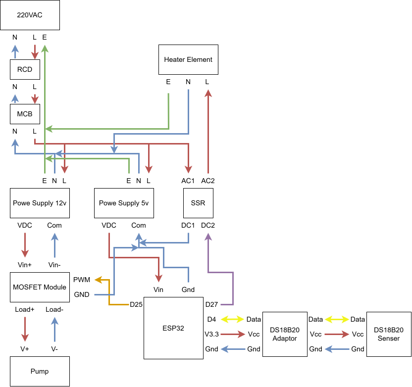

The mains path is 220 VAC, then RCD, then MCB, then distribution to the 12 V supply, the 5 V supply and the SSR. The heater's earth conductor is bonded to the supply earth. The logic side (5 V and 3.3 V) is separated from mains by the opto-isolated MOSFET module and by the SSR input stage.

## Firmware

The firmware lives in [`firmware/WaterHeaterPID`](firmware/WaterHeaterPID) and is split into small single-purpose modules.

| Module | Responsibility |
|---|---|
| `WaterHeaterPID.ino` | Setup and the non-blocking main loop |
| `Config.h` | Pins, limits, scaling factors, register addresses, state and fault codes |
| `SharedState` | Process variables shared across modules |
| `TemperatureSensor` | Asynchronous DS18B20 reads with validity check |
| `PidController` | Wraps the PID_v1 library: tunings, mode, output limits, auto/manual |
| `Heater` | Time-proportional SSR output |
| `Pump` | 20 kHz LEDC PWM, compatible with ESP32 Arduino core v2 and v3 |
| `SystemController` | Run/stop state machine and fault handling |
| `SafetyMonitor` | Sensor-validity and over-temperature supervision |
| `ModbusInterface` | Modbus TCP server, scaling, validation of incoming settings |
| `SettingsStorage` | Persists setpoint and gains in non-volatile storage and validates them at boot |
| `WifiManager` | Static-IP connection with automatic reconnect |
| `StatusPrinter` | Serial diagnostics |

### Timing

`loop()` never blocks. On every iteration it services Modbus, maintains Wi-Fi and updates the heater window. Every 2 s it executes the control sequence in this order: read sensor, read settings from Modbus, process run/stop commands, safety check, PID compute, publish status. The DS18B20 conversion is started right after each read and collected on the next one, so the 11-bit conversion time never stalls the loop.

### Control strategy

- PID from the PID_v1 library: proportional on error, derivative on measurement (no derivative kick on setpoint changes), integral term clamped to the output limits
- Output limited to 0-100 % and sample time set to 2 s
- Converted to heater ON time inside a 2 s window, so the effective heating power is `out % x 800 W` on average
- Run, stop and Manual mode are commanded by Modbus coils; in Manual mode the output is taken directly from a holding register

### Modbus TCP interface

The ESP32 is a Modbus TCP server at `192.168.0.150:502` (static IP, set in `Config.h`). Addresses are zero-based protocol addresses.

| Type | Address | Name | Scale | Access |
|---|---|---|---|---|
| Coil | 0 | Run | - | R/W |
| Coil | 1 | Manual mode | - | R/W |
| Holding register | 0 | Setpoint (°C) | x10 | R/W |
| Holding register | 1 | Kp | x100 | R/W |
| Holding register | 2 | Ki | x100 | R/W |
| Holding register | 3 | Kd | x100 | R/W |
| Holding register | 4 | Manual output (%) | x10 | R/W |
| Input register | 0 | Temperature (°C), signed | x10 | R |
| Input register | 1 | Heater output (%) | x10 | R |
| Input register | 2 | System state (0 stopped, 1 running, 2 fault) | - | R |
| Input register | 3 | Fault code (0 none, 1 over-temperature, 2 sensor) | - | R |
| Input register | 4 | Safety trip limit (°C) | x10 | R |
| Input register | 5 | Setpoint minimum (°C) | x10 | R |
| Input register | 6 | Setpoint maximum (°C) | x10 | R |
| Input register | 7 | Maximum allowed gain | x100 | R |

The limit registers (4 to 7) let the HMI read its validation bounds from the controller instead of hard-coding them. Incoming writes outside the allowed range are rejected and the controller republishes its current valid values.

### UI

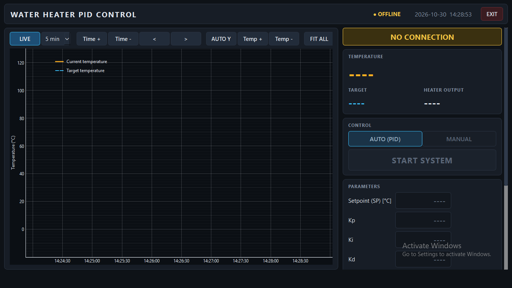

## Safety

The system switches 220 V and 800 W into water, so protection is layered: hardware that works with no software at all, and firmware that assumes the sensor, the network or the operator can fail.

### Electrical protection

| Measure | Purpose |
|---|---|
| 30 mA RCD at the inlet | Disconnects on earth-leakage current, protecting the user from shock |
| 10 A Type C MCB | Overcurrent and short-circuit protection of the whole panel |
| Protective earth bonded to heater and supplies | Fault current has a defined return path to trip the RCD |
| Opto-isolated MOSFET module and SSR input | No galvanic connection between mains and the ESP32 |
| Separate SELV supplies (12 V pump, 5 V logic) | Low-voltage side is fully isolated from the mains side |
| Heater with its own thermostat | Independent hardware backstop if firmware misbehaves |
| Heat-sinked SSR, enclosed cable ducts, numbered wire markers | Thermal margin, no exposed conductors, traceable wiring |

### Firmware protection

| Measure | Behavior |
|---|---|
| Safe boot | Heater output is driven low and the pump off before anything else runs |
| Over-temperature trip | At 60 °C or above the system enters FAULT: PID disabled, heater off, pump off, Run request cleared |
| Sensor-fault trip | A reading outside -10 to 100 °C (this includes the -127 °C a disconnected DS18B20 reports) enters FAULT with the same actions |
| Latched fault | After a trip the Run coil is cleared; the operator must command Run again, which resets the fault code |
| Setpoint ceiling below the trip | Setpoint is limited to 10-55 °C, so normal operation never approaches the 60 °C trip |
| Input validation | Setpoint and gains are range-checked on every Modbus write and on boot; invalid values are discarded |
| Heater gating | The heater can only turn on while the system state is RUNNING |

> **Warning.** This is a mains-powered device. Build and test it only if you are qualified to work with 220 V, always keep the RCD and MCB in circuit, and never energize the heater out of water.

## Tuning and results

Tuning was done manually on the real plant by trial and error, changing one gain at a time and judging the response by overshoot and steady-state error. All runs below are logged from the actual system with Kd = 0 unless noted.

| # | Kp | Ki | Kd | Setpoint | Overshoot | Steady-state error |
|---|---|---|---|---|---|---|
| 1 | 10 | 0 | 0 | 45 °C | 0.0 °C | -2.08 °C |
| 2 | 20 | 0 | 0 | 48 °C | 0.0 °C | -1.02 °C |
| 3 | 40 | 0 | 0 | 55 °C | 0.0 °C | -0.60 °C |
| 4 | 40 | 1 | 0 | 40 °C | 1.6 °C | +1.36 °C |
| 5 | 40 | 0.5 | 0 | 40 °C | 1.9 °C | +1.32 °C |
| 6 | 40 | 0.25 | 0 | 40 °C | 2.0 °C | +1.95 °C |
| 7 | 40 | 0.02 | 0 | 55 °C | 0.0 °C | -0.21 °C |
| 8 | 40 | 0.03 | 0 | 40 °C | 1.3 °C | +1.30 °C |
| **9** | **40** | **0.03** | **1** | **46 °C** | **0.1 °C** | **+0.02 °C** |

### Step 1: proportional only

  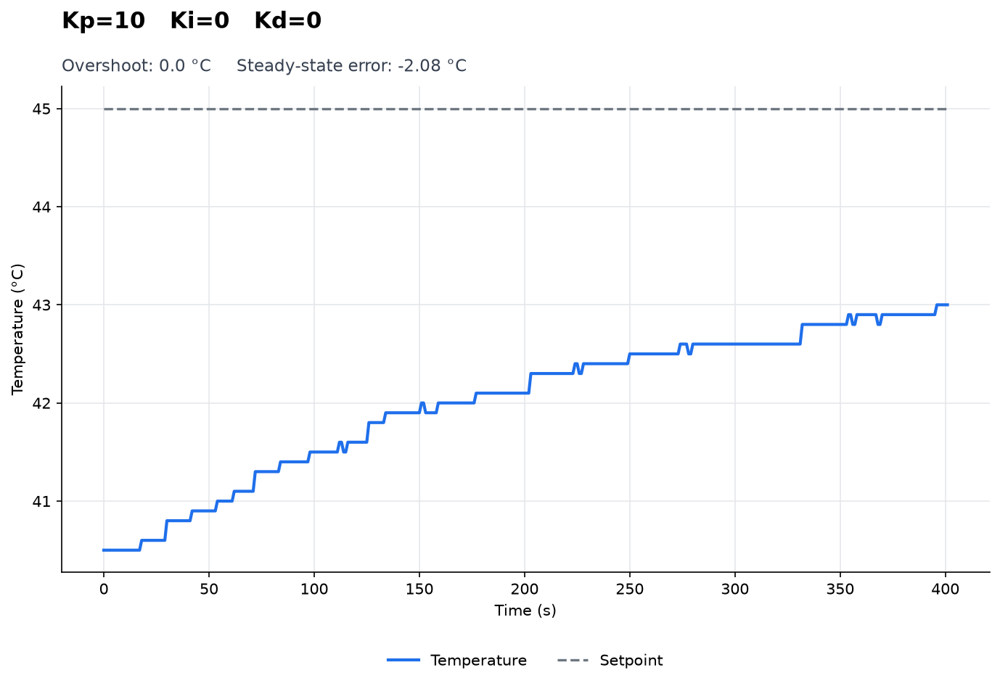
  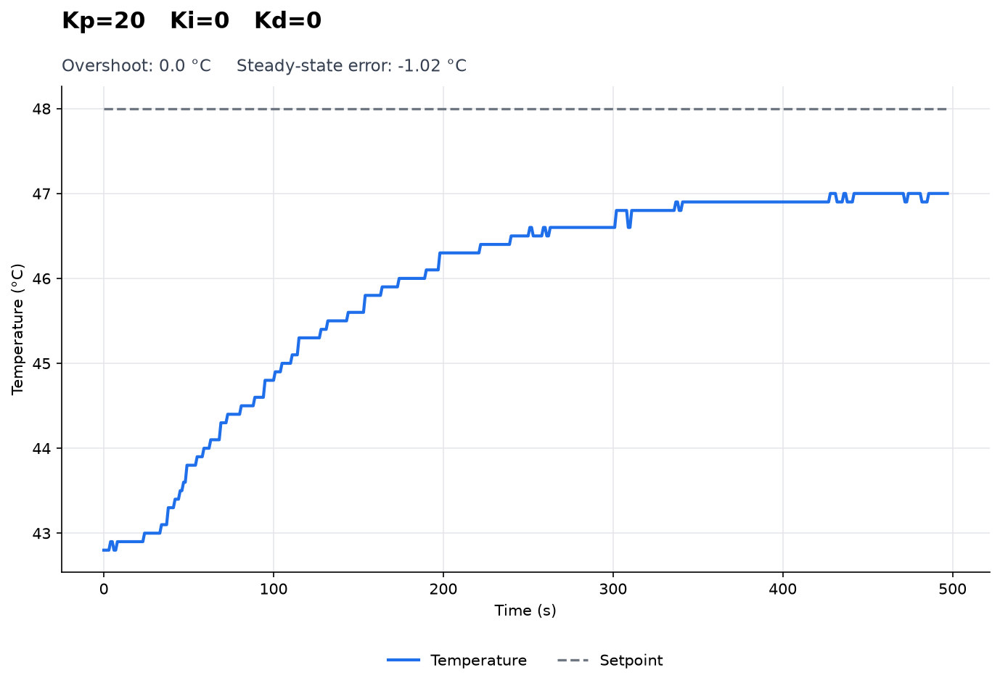
  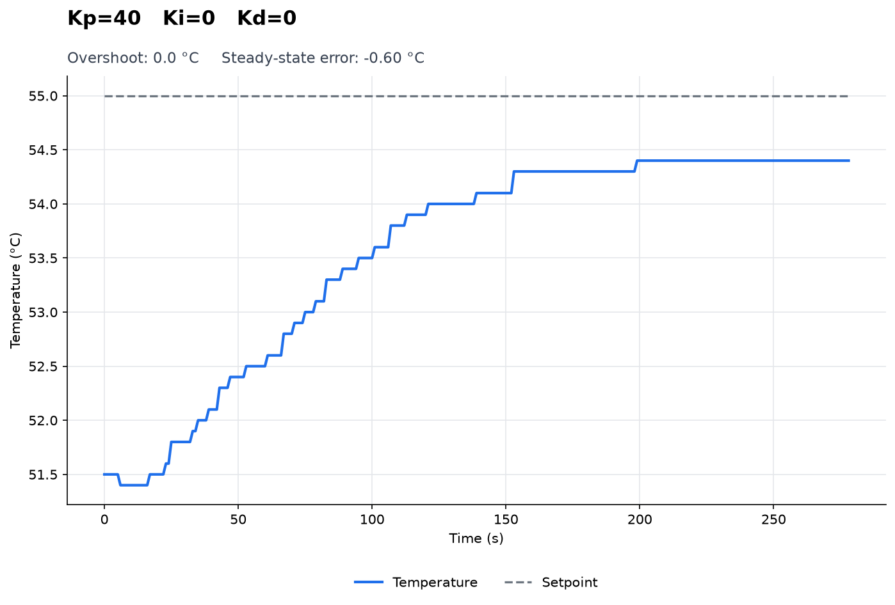

Raising Kp from 10 to 20 to 40 cut the steady-state error from 2.08 to 1.02 to 0.60 °C with no overshoot. The plant is a heater with only passive cooling, so holding a temperature above ambient needs a constant power. Multiplying each steady-state error by its Kp gives a required hold output of roughly 20-24 %, which matches across the three runs (and rises with setpoint, as heat loss does). This is the signature of a P-only loop that needs an integral term to remove the offset. With Kp = 40 the output saturates at 100 % whenever the error exceeds 2.5 °C.

### Step 2: adding integral action

  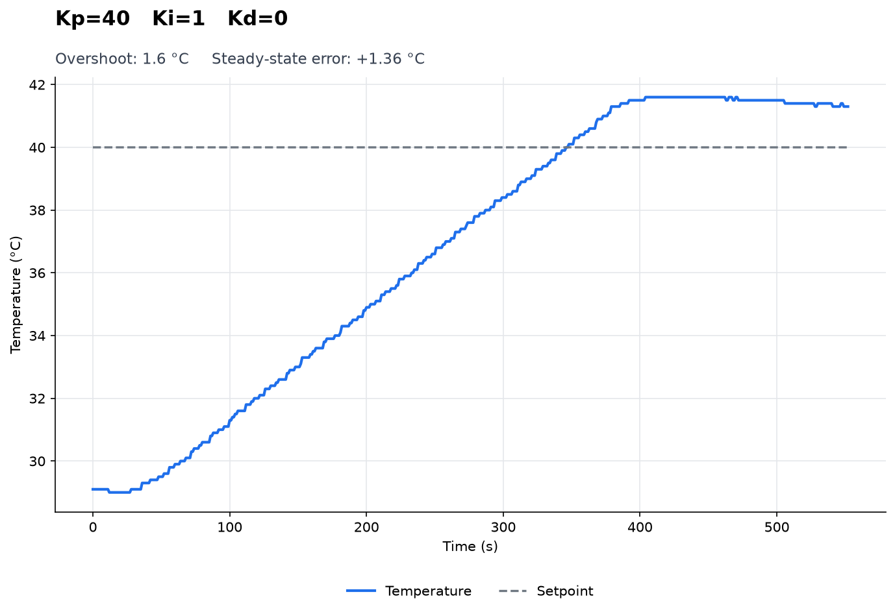
  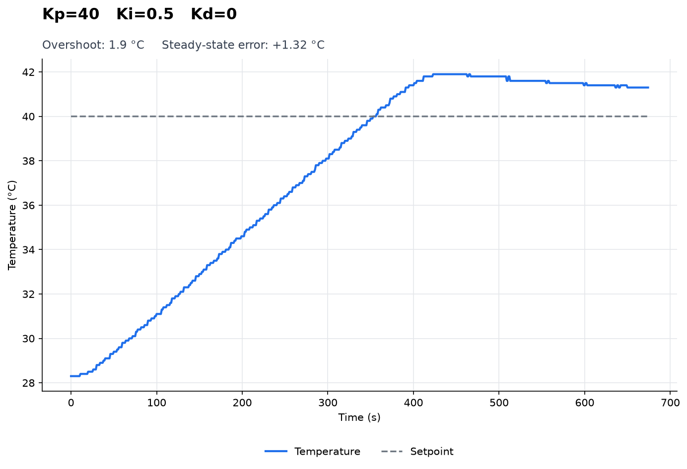
  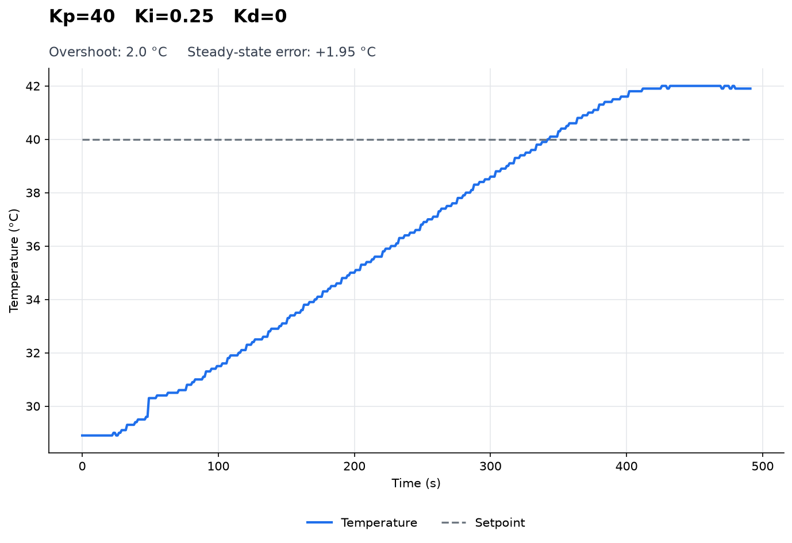

With Ki = 1, 0.5 and 0.25 the temperature overshot by 1.6-2.0 °C and then drifted back only slowly. Because the heater cannot cool the water, any overshoot can only decay through heat loss, so a positive error persists for a long time. The likely cause is integral accumulation during the long, saturated ramp from about 29 °C: the integral term is already large when the temperature reaches the setpoint. Lowering Ki did not remove the overshoot in this range.

  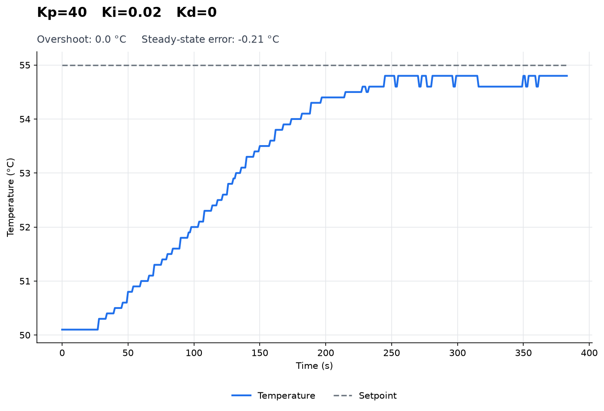
  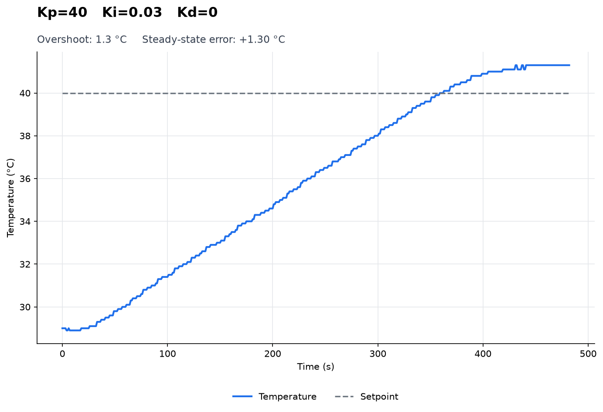

Ki = 0.02 (at a 55 °C setpoint, starting near 50 °C) gave no overshoot and 0.21 °C of residual error. Ki = 0.03 (at a 40 °C setpoint, starting near 29 °C) overshot by 1.3 °C again, which points at the large initial step rather than only the value of Ki.

### Step 3: adding derivative action

  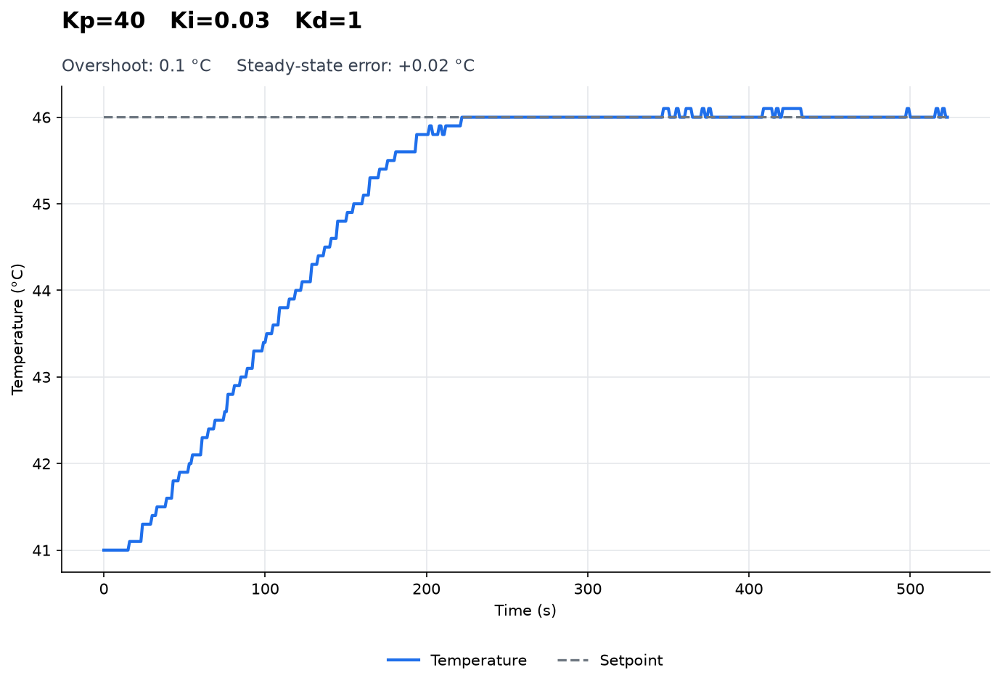

Adding Kd = 1 to the same PI gains produced the best response: the temperature climbs at full power, then the derivative term, acting on the measurement, throttles the heater as the rate of rise is still high near the setpoint. The result is 0.1 °C overshoot and a steady-state error of +0.02 °C, which is inside one sensor step. The small 0.1 °C excursions after settling are single-LSB toggles of the 0.125 °C sensor resolution, not loop oscillation.

### How to read these results honestly

- The runs were not all done from the same starting temperature or to the same setpoint, so the comparison between runs 4-8 (large step from about 29 °C) and run 9 (5 °C step from 41 °C) is not like for like. The conclusion that Kd fixes the overshoot is the most plausible reading, but a controlled repeat at the same step would confirm it.
- Slow runs (for example Kp = 10) had not fully settled when logging ended, so their reported errors are the value at the end of the window.
- Tuning was manual. An auto-tune or relay-feedback identification of the plant model would be the next step to put the gains on a quantitative basis.

## Practical photos

### Control panel

  

  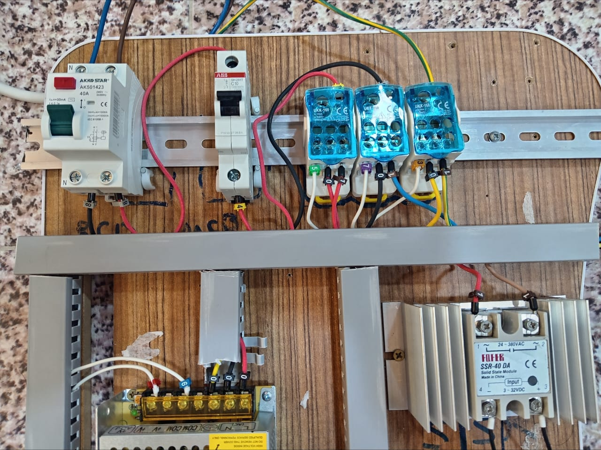
  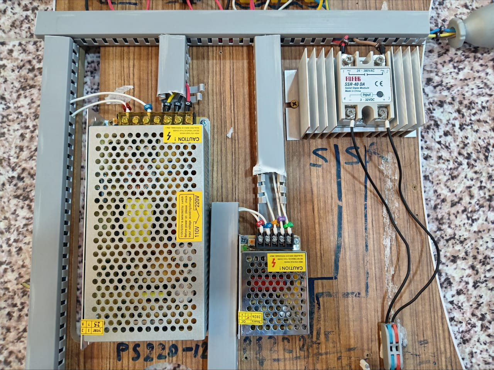

Top left: RCD, MCB and the three distribution blocks. Bottom: the 12 V and 5 V supplies and the heat-sinked SSR-40DA, all routed through cable ducts.

  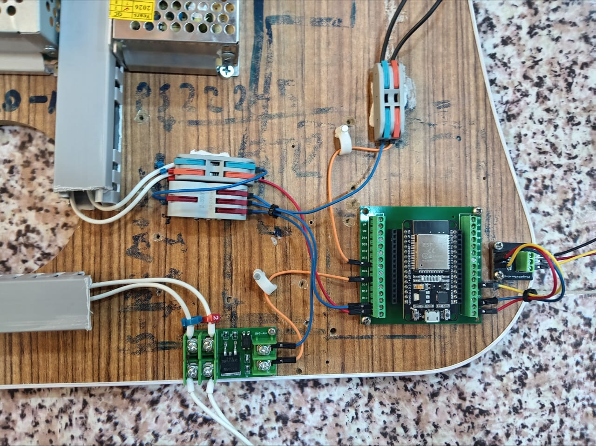

The ESP32 on a screw-terminal breakout, the opto-isolated MOSFET module for the pump, push-in connectors for distribution, and the DS18B20 adaptor board at the right edge.

### Test tank

  
  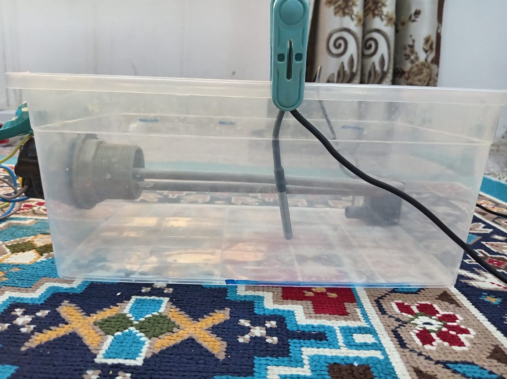

The 800 W immersion heater, the 12 V submersible pump and the DS18B20 probe, with the probe clipped to the tank wall so it sits in the circulated water.

## Getting started

### Requirements

- ESP32 DevKit V1
- Arduino IDE or PlatformIO with the ESP32 Arduino core (v2 or v3)
- Libraries: `PID` (PID_v1), `modbus-esp8266` (ModbusIP_ESP8266), `OneWire`, `DallasTemperature`
- A Modbus TCP client for supervision (the project was commissioned with AdvancedHMI on Windows; any client such as a SCADA package or `pymodbus` works with the register map above)

### Build and flash

1. Open `firmware/WaterHeaterPID/WaterHeaterPID.ino`.
2. In `Config.h` set `WIFI_SSID`, `WIFI_PASSWORD` and the static network values (`IP_LOCAL`, `IP_GATEWAY`, `IP_SUBNET`, `IP_DNS`) to match your network.
3. Build and flash to the ESP32. The serial monitor at 115200 baud prints `T`, `SP`, output, state and fault every 2 s.
4. From the Modbus client, write the setpoint and gains, then set coil 0 (Run) to start.

Credentials in this repository are placeholders. Do not commit real Wi-Fi credentials.

## Limitations and future work

- **No communication watchdog.** If the Wi-Fi or the HMI is lost, the controller keeps running at its last setpoint. This is bounded by the 55 °C setpoint limit, the 60 °C trip and the heater thermostat, but a heartbeat register that stops the heater after a timeout would be better practice.
- **Single sensor.** There is no redundant sensor or independent hardware over-temperature cutoff other than the heater's own thermostat.
- **Safety checks run on the 2 s control tick** and only while the system is running.
- **Modbus is unauthenticated** and intended for a trusted LAN.
- **Manual tuning only.** Plant identification and auto-tune would make the gains reproducible for other tank sizes.
- **Heating only.** The plant has no active cooling, so overshoot is corrected only by heat loss; this shaped the tuning and limits how fast the loop can recover.
- **Planned:** data logging and trend plotting, auto-tune, communication watchdog, and a setpoint-ramp feature to avoid the large integral build-up on big steps.

## Author

Name: Mostafa Abdel Razzak
Email: mustafaabdalrazzak2002101@gmail.com

You can reach out for any questions, collaborations, or feedback regarding this project.
